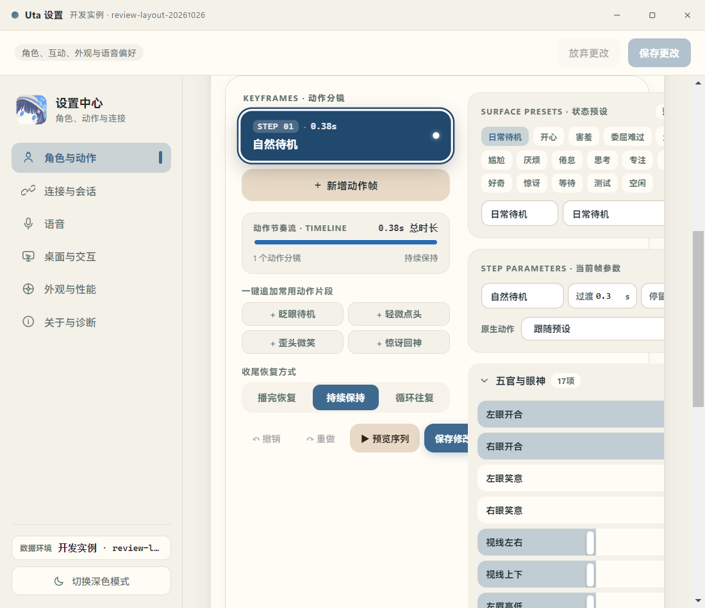

# Uta 2026-10-26 审查与完成度评估

> 历史记录：本文针对修复前 `79d8d64`。其中 5 项已有后续修复；当前完成度与新发现请读 [最新重评](ASSESSMENT-2026-10-26.md)，不要把下文的问题清单当作当前开放状态。

审查基线：`main / 79d8d6418e087007c51d69d3739aea3a14781bc3`，应用版本 `0.2.0-alpha.16`。开始时工作区干净，没有运行中的 Uta/Electron 实例；当前会话的 Uta MCP 工具已注册，但能力查询报告运行端不可用。

## 结论

当前适合继续受控 Alpha 体验，尚不满足 1.0 发布条件。设置中心、首次引导、桌宠基本交互和候选构建已有完整骨架；主要问题已经转为跨操作的数据保护、多实例连接归属、工坊可用性以及真实使用验收。

本轮确认 **5 项问题：1 项 P1、4 项 P2**，均有执行生产模块或组件的探针证据。没有修改业务代码、安装宿主插件或提升日常版本。此前“换模型/关窗有草稿保护”不能代表所有切换操作都已保护。

昨天有 81 个提交，相对 `049220026a838eb879f276a126831e7525524f13` 涉及 307 个文件。本轮按提交与风险面调查首次引导/安装、运行桥与宿主绑定、模型及工坊、语音配置、Markdown、设置主题和窗口；不是逐行形式化审计全部改动。前一轮报告只作线索，以下结论以本轮证据为准。

## 已确认的问题

### 1. [P1: 同平台多实例覆盖宿主端点，开发实例可能抢走日常连接]

位置：`app/src/main/index.ts:91–92`；`app/src/main/runtime-bridge.ts:614–616,627–634`；`plugin/shared/uta-runtime-client.mjs:24–36`。

`boundHostEndpointFile()` 不看 profile/userData，把所有绑定到同一平台的实例发布到同一个 `%APPDATA%/uta/host-pets/<host>/runtime-endpoint.json`。Runtime Bridge 无条件替换该文件，不检查当前所有者是否仍存活；单实例锁只约束同一 userData，不能保护这个共享路径。

复现：在本轮私有目录启动两个真实 Runtime Bridge，使用不同的主端点、相同的宿主专属端点。正式客户端先发现第一只；第二只启动后改为发现第二只；第二只退出后端点被删除，第一只的 `/health` 仍正常，但正式客户端已经找不到它。四个断言全部成立。

影响：日常实例与开发/候选实例绑定同一宿主时，真实 hooks/MCP 可能流向后启动的实例；后者退出后连接仍不能回到在线的原实例。仅用 token 防止“误删别人的文件”不能修复此前的覆盖。

建议：先明确共享宿主端点的所有权，开发/验收默认使用显式的私有端点；共享发现必须检查活跃所有者、处理冲突并给出可见结果，不得静默替换。验收需覆盖同宿主的日常+开发、候选+Pets、先后退出和崩溃恢复。

证据：`.tmp/review-20261026/endpoint-probe.cjs` 与 `endpoint-probe.json`。这是两条真实回环服务及正式客户端的模块实验，Electron 窗口用替身；没有把真实日常平台端点用于复现。

### 2. [P2: 在动作库切换预设会丢失工坊草稿及撤销历史]

位置：`app/src/renderer/components/SettingsPanel.vue:803–831,1265–1272`，动作库入口 `SettingsStatesTab.vue:250`。

复现：在工坊修改名称与 `ParamAngleX:12`，回到动作库，点击另一个预设。`applyStatePreset()` 直接调用 `loadPresetIntoEditor()`，没有保存/放弃/继续编辑的门控；后者调用 `markWorkshopClean()`，同时清空原撤销历史。

执行真实 SFC setup 与切换函数后，草稿由 `dirty=true, canUndo=true` 变为 `dirty=false, canUndo=false`，名称和参数都已替换。旧草稿既不能关闭时再保存，也不能撤销找回。此调用路径早于昨天，属于当前仍未收口的旧问题，不声称由昨天界面重做引入。

建议：凡是替换工坊编辑对象的入口都复用同一份草稿保护，包括点选、钉住其他预设及新建变体；只播放其他预设时也可保留原编辑草稿。不能只保护换模型和关闭窗口。

证据：`.tmp/review-20261026/component-probes.cjs` 与 `component-probes.json` 的 `presetDraftSwitch`；使用生产组件脚本，模型执行与浏览器环境为受控替身。

### 3. [P2: 工坊双列断点按窗口判断，常见中等宽度发生裁切与按钮重叠]

位置：`app/src/renderer/components/SettingsStudioTab.vue:586–591,772–778`；`app/src/renderer/components/styles/settings-panel.css:1402–1406`。

双列至少需要 `260 + 320 + 22` 像素，另有底板内边距；单列只在视口小于等于 680px 时启用，未扣除侧栏和多层容器内边距。操作按钮行同时没有换行。

在最新构建、真实 Electron 的 Hiyori 设置窗口测得：

| 窗口宽度（CSS px） | 工坊底板 clientWidth / scrollWidth | 右侧编辑列最右位置 | 结果 |
| --- | --- | --- | --- |
| 1080 | 728 / 728 | 990 | 双列可容纳 |
| 960 | 608 / 622 | 904 | 已溢出底板 |
| 880 | 528 / 622 | 904 | 编辑列超出窗口，部分输入不可见，保存按钮受相邻列遮挡 |
| 760 | 474 / 622 | 852 | 裁切更严重 |
| 600 | 516 / 516 | 536 | 单列恢复正常 |

建议：依据工坊实际容器宽度切列，或提高断点并验证侧栏仍显示的范围；按钮行允许换行。应测中等宽度，不能只测最大窗口和最窄单列。

证据：`.tmp/review-20261026/layout-probe.json`。窗口由生产主进程/preload/renderer 加载，用正式设置 API 打开，再通过合成 DOM 点击进入工坊；尺寸和截图由 Electron 采集。这不是原生鼠标点击验收。

### 4. [P2: 常用动作片段只更改名称和时长，没有生成对应动作]

位置：`app/src/renderer/components/SettingsStudioTab.vue:552–574`，`SettingsPanel.vue:911–924`。

“眨眼待机 / 轻微点头 / 歪头微笑 / 惊讶回神”都调用 `addEditingStep()` 复制当前帧，再修改 label/durationMs/holdMs，未改眼睛、头部、嘴形、控件或原生动作。

真实父子 SFC 的组合探针从空参数中性帧依次追加四种片段，所有新帧的 `parameters` 仍为 `{}`、`controls` 仍为 `[]`；从其他帧追加则继续复制旧姿态。用户看见新的动作名，实际只是同姿态停留。

建议：按模型已确认能力生成真实关键帧/调用真实资源，缺能力时禁用并说明；若暂时只提供时间模板，名称必须准确说明其用途。

证据：`component-probes.json` 的 `snippets`。本轮执行了真实 `addQuickSnippet()` 与真实 `addEditingStep()`，不是重新实现一份算法作测试。

### 5. [P2: 强调色文字算法回退，多种内置颜色不再满足原先对比度约定]

位置：`app/src/renderer/services/color-contrast.ts:45–48`；`app/tests/color-contrast.test.cjs:8–32`；`AppearanceDomain.vue:188–195`。

最新实现对亮度不大于 0.40 的颜色直接返回白字，没有计算白字是否达到项目此前采用的 4.5:1。正式测试从验证对比度改为验证固定白色，所以本轮套件全绿仍会漏过回退。

执行正式 helper 得到：浅雾蓝 `#5c87a3` 为 3.854:1、苔绿 `#6f8f7f` 为 3.552:1、灰紫 `#8a7f9e` 为 3.743:1、暖沙 `#a9825c` 为 3.480:1；旧琥珀色也只有 3.576:1。默认雾蓝 5.752:1，陶红 4.659:1，说明不是全部颜色都失败。

影响：选择上述内置色时，保存按钮等小字号强调色控件会统一使用对比不足的白字；深浅主题都使用这个 helper。

建议：恢复根据实际对比度选择文字/调整填充色，并对全部内置色、自由选色、hover/pressed 状态测试可读性。若坚持白字，则限制或调整背景，不能降低测试约定来通过。

证据：`component-probes.json` 的 `contrast`。

## 源码、候选包与日常交付

现有 alpha.16 ZIP 的实际 SHA-256 是 `666f601bafd75f7a4a5a5bb3a90e801d3f72369c37f447ac9b689893e3f1c1f7`，与 manifest 一致，来源 `2b5466579c3d1793d6641093275b1a4ca21e3305`。

此后还有 9 个涉及应用源码的界面提交，直到审查基线 `79d8d64`。当前版本号仍叫 alpha.16，但该 ZIP 没有这些新界面；本轮 `npm run build` 仅生成源码构建，不是新候选包。因此旧 alpha.16 截图/验收不能证明最新工坊界面已验收。这是交付缺口，不把“正在开发的源码尚未重新打包”本身列为业务缺陷。

CURRENT/HANDOFF 顶部原记录提到正在运行的 alpha.14，是昨天的现场；本轮开始和收尾的当前进程清点均没有用户日常 Uta，不能继续引用那个运行状态。

## 完成度：按用户旅程判断

下表依据当前源码、本轮检查和仓库中有日期的既有验收记录，区分“有实现”与“完整验收”。不把测试数量或改动行数换算为完成百分比。

| 旅程 | 当前状态 | 距离结项的关键缺口 |
| --- | --- | --- |
| 解压启动、首次引导、独立设置 | 待审查；已有可运行候选和真实引导历史证据，本轮也载入了最新引导与设置 | 最新源码候选包、干净 Windows、升级副本与全流程复验 |
| 设置保存、数据恢复、跨窗口草稿 | 主链路成形，仍在收尾 | 切预设草稿丢失；关闭/换模/新建等替换操作应使用一致保护；本轮没有重演全部真实磁盘恢复场景 |
| 日常桌宠交互与表现 | 主要交互可用，表现系统进行中 | 已有工作状态、保持部件、安静模式、头眼嘴试验及日常微表现；完整通道协调、持久校准、强度入口与同脚本观感验收仍未形成完整闭环 |
| 模型与预设工坊 | 主要编辑链路存在，未完成收口 | 本轮发现的草稿、布局、动作片段问题；DS/Hiyori/静态立绘的完整兼容脚本；当前公共默认资源仍是 Hiyori 与静态示例 |
| 语音配置、播报、听写 | 实现覆盖较多，真实验收不足 | 本地+云端真实有声 TTS、真实麦克风、权限/设备失败、取消和宿主发送归属；受控 PCM/模拟接口不能替代这些验收 |
| 四个主要宿主与多实例 | 已有接入实现与部分专项证据，仍未结项 | 本轮多实例端点覆盖；Codex 安装/握手有 10-25 专项证据，Qoder 有部分事件记录，仍需四平台逐项补齐重连、取消、审批及支持范围矩阵 |
| 1.0 发行质量 | 进行中，发布门槛未满足 | 8 小时/7 天、双屏/DPI、睡眠唤醒、干净电脑、默认 DS 模型分发、最终 ZIP/升级/回滚与用户验收 |

产品阶段判断：**仍在 0.2 设置中心候选收尾；0.3–0.7 已有交叉实现，不能因版本表靠后就认为完全没做；0.8–1.0 的质量与发行验收尚未完成。** 优先完成当前可用功能的可靠性，比继续扩界面更有收益。

## 本轮验证与限度

- 应用 `npm test`：913 项，908 通过、5 跳过、0 失败。5 项跳过均因 `.uta-task/model-input` 的真实 DS fixture 不可用，不计通过。
- 插件 `npm run test:plugin`：105/105。
- node/web 类型检查、`npm run build`、三份接口契约脚本全部通过。构建有现有 Vite CJS 与 Cubism 非 module 脚本提示，未导致失败。
- 额外探针：同平台共享端点冲突、真实父子 SFC 的快捷片段、切预设草稿丢失、正式颜色 helper、真实 Electron 的五档窗口布局均复现相应问题。
- 新构建的 Hiyori 角色与设置页实际加载；品牌 SVG 在 `file://` 下成功载入，未误报为资源缺失。
- 原生 Computer Use 可读取桌宠画面，但操作/重新选择激活均报 `failed to activate captured window`。停止该路线；Electron 合成点击与截图不能冒充原生点击、拖动或快捷键验收。
- 未调用真实付费 TTS/STT、安装器或宿主对话；未做本轮真实云音色、麦克风、四宿主新会话、长时运行、多屏和新 ZIP 验收。
- 本轮是审查，复现脚本断言“当前缺陷存在”，修复时必须转成断言“缺陷已消失”的正式回归。组件探针首次因缺少 `releaseModelWorkshop` 的测试替身失败，补齐替身后复现成功；该失败不是应用异常。

## 交接与建议顺序

1. 先修 **[P1: 同平台多实例覆盖宿主端点]** 和 **[P2: 切预设丢失工坊草稿及撤销历史]**。
2. 收口 **[P2: 工坊中等宽度裁切]**、**[P2: 常用动作片段未生成动作]**、**[P2: 强调色文字对比度回退]**，用真实组件和真实渲染补回归。
3. 从同一最终提交重新生成有明确版本/来源的候选 ZIP，复验最新界面与升级副本。
4. 补齐真实语音、四平台链路和长时/DPI验收，再判断是否离开候选阶段。

本轮临时数据与日志位于 `D:/Frankenstein/Uta/.tmp/review-20261026/`。运行 profile 为 `review-20261026`、`review-observe-20261026`、`review-settings-20261026`、`review-layout-20261026`，userData/runtime、CODEX_HOME、DSH_HOME 都指向本轮目录；保持未绑定真实宿主，没有发布到日常 host-pets 目录。

临时观察实例 PID 为 2740、27004、2016，均按探针的退出逻辑结束。原生观察实例 PID 22016 经核对路径及本轮 PID 记录后停止；清理仅针对本轮进程和本轮端点。收尾已核对 Uta/Electron 进程与本轮端点均为零，原生观察实例的监听也已消失；模块探针在 finally 中关闭两条服务。业务源码保持审查基线，只提交本报告、截图和统一入口的交接增量。
