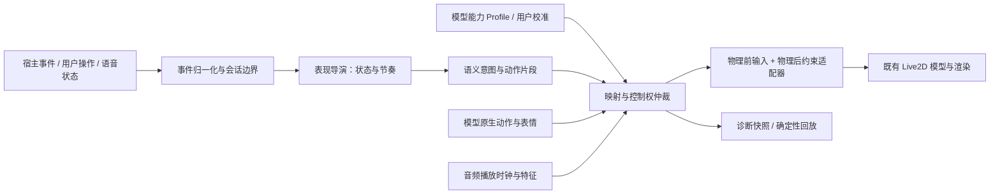

# Live2D 表现系统：架构、迁移与验收

日期：2026-10-23；提案，未实施。配合 [产品总方案](../PRODUCT-PLAN-2026-10-23.md)、[参考研究](live2d-reference-study.md)、[任务包](../workflow/product-task-catalog.md) 使用。

## 1. 对问题的界定

目前不是“Live2D 不能动”，而是已有能力还未形成统一的表现系统。代码证据：

| 现有位置 | 已有能力 | 本轮需要解决的结构问题 |
| --- | --- | --- |
| `app/src/renderer/composables/useMotionPriority.ts` | Idle/Reply/Interaction 优先级，播放/循环令牌，换模 reset | 播放入口的布尔返回先表示请求进入，底层异步结果稍后返回；非 Idle 层有 5 秒释放，尚不是按通道、按实际结束时间的全局控制权 |
| `useExpressionState.ts` | 同情绪 pulse、6 秒回退、说话期间延后、neutral 清残留 | 离散状态与固定计时主导；与动作/语音长期状态的协调需要统一生命周期 |
| `services/live2d/loader.ts` | 参数 stack、原生表情、注视叠加、物理前插值、物理后部分覆盖、口型保护 | 多处写 Core 是历史兼容策略，不能简单再加一个最后写入器；需明确阶段与 owner |
| `useLive2DAnimation.ts` | 调整 SDK 自带呼吸与眨眼，避免重复 rAF 争用 | 新自然动作必须接管/释放 SDK 对应通道，不得叠两套眨眼/呼吸 |
| `useStageRenderLoop.ts`、`services/mouth-motion.ts` | TTS 音量驱动、文本时钟回退、平滑口型、活动降帧 | 真实音频已存在；后续是时钟、发音/停顿、释放与姿态协同，不能重复立项“新增真实振幅口型” |
| `usePresetController.ts`、`useCompanionDirector.ts`、`emotion-adapter.ts` | 用户预设/动作序列、陪伴行为、模型适配 | 保留创作资产，让它们成为表现层的输入与资源，不强制用户重做 |

这些是源码结构观察，不等于所有症状都已经复现。先录制当前模型的固定事件基线，确认覆盖、抽动、节奏重复、回退突兀分别出现在哪里，再逐项证明改善。

## 2. 可感知的目标

同一角色在“安静待机→接到任务→思考→找到结果→解释→停顿→继续→完成”过程中，眼神、头身、表情和口型能互相配合。回应要及时，但不每条 token 点一次头；说话有停顿，停下来能闭嘴，任务结束能恢复自然状态。

表现层不宣称理解 Agent 的内心。默认使用可信结构化事件与显式情绪意图；从文本推断只是可选低置信度输入。错误、审批、工具执行是否成功以宿主/运行时的事实状态为准。

## 3. 目标模块与数据流

分工：

- **事件归一化**：去重、会话/绑定校验、TTL、取消、旧模型 epoch 拦截；不做每帧参数写入。
- **导演**：维护 idle/listening/thinking/speaking/awaiting-approval/recovering 等状态及过渡；规定何时表达与何时安静，不处理 Cubism 数值。
- **语义运动层**：头身、眼神、眉眼、嘴形、呼吸等标准语义；可用连续效价/唤醒/支配度（Valence/Arousal/Dominance，本文 VAD 仅指情绪三维）。FACS/AU 只是中间语义工具，不能保证任意模型具备对应肌肉控制。
- **映射与仲裁**：查询当前模型能力，把语义值转换为真实参数；按通道获得/叠加/释放控制权；输出边界内结果。
- **渲染适配器**：独占 Uta 自有层到 Core 的写入接口，保留 Cubism 的运动/物理更新顺序；不拥有设置持久化和网络请求。
- **诊断/回放**：采样意图、通道 owner、降级原因和阶段结果，默认不记录聊天正文/音频/密钥。

“独占写入接口”不是强行让整个 Cubism 只调用一次 setParameter。SDK/物理仍有自身更新；Uta 自有写入集中管理，并明确区分物理前输入与物理后最终约束。

## 4. 待冻结契约

以下为设计字段，不是已经存在的 API。实施第一项任务需提供版本化类型、校验、fixture 和兼容策略后冻结；其他 Worker 不可自行更名扩展。

### 4.1 表现事件与执行结果

`PerformanceIntent`：`version`、`intentId`、`source`、`sessionId?`、`bindingGeneration`、`modelEpoch`、`kind`、`issuedAt`、`ttlMs`、`intensity`、`seed`、`payload`。

- `source` 枚举 user/host/speech/workshop/system，便于诊断与权限区分。
- `kind` 枚举 state/emotion/gesture/native-animation/cancel；不同 kind 使用不同 payload，不接受无限制任意键值。
- 远端输入只接受白名单语义和已经公开的动作引用。逐帧原始参数、文件路径与任意优先级不得直接来自 Agent。
- 时间：事件到达本机后转换到单调时钟；音频用实际播放时钟；不直接混用 Date.now、performance.now 与 AudioContext.currentTime。
- `modelEpoch` 换模递增；旧模型计划/异步加载/定时器一律不能写新模型。`bindingGeneration` 在重新绑定时递增；合法 profile 和错误会话同样要拒收。
- `ttlMs` 从接受时本机单调时钟计算；初版不同 kind 的 TTL/强度/时长上下限集中配置并写 fixture，不能由每个来源任意放大。

执行状态建议 accepted/started/completed/cancelled/expired/rejected/degraded；附 `intentId`、原因、实际模型版本、可用效果。accepted 仅表示接受调度，不能当成画面完成。completed 可表示运行时结束；真实画面验收仍需截图/录屏或受控 GUI 测试。

### 4.2 模型 Profile

`ModelCapabilityProfile` 至少包含：schemaVersion、模型内容签名、参数 ID/范围/默认值、参数标签、native motions/expressions、语义映射、覆盖来源、置信度、校准版本、可用能力与降级原因。

- Core 的实际范围与模型文件为结构事实；CDI 标签是可选提示，不是语义真值。
- 区分可连续参数、离散开关、部件透明度、物理输出；私有参数不可统一按 [-1,1] 线性扫。
- 映射支持反向、死区、非对称范围、曲线、平滑速度；未知参数默认不驱动。
- 原生 exp3 的 Add/Multiply/Overwrite 必须尊重其语义；列出它占用的参数，不能一概当“加一个数”。
- 原生 motion 的 group/index 与资源签名绑定；缺失不占控制权，不能播放成功后才发现不存在。
- 文件来源、自动建议、用户覆盖分开；覆盖存 profile userData 的模型签名命名空间，不自动写共享模型旁车。
- 模型更新导致签名变化时提示复核/重新校准，不把旧数值悄悄套到新范围。

### 4.3 控制层与快照

`LayerContribution`：ownerId、generation、channelMask、mode（replace/add/multiply）、weight、start/expiry、fadeIn/out、phase、values。贡献只对允许的语义/参数生效。

`PerformanceSnapshot`：active intents、state、modelEpoch、通道 owner/来源、当前/目标值、clamp 次数、降级、队列长度、音频时钟偏移。UI 低频订阅；每帧数据在渲染端本地处理。

## 5. 通道控制规则

优先级不能只有一个全局数字。眼神、眼睑、嘴部开合、嘴形、眉毛、头身、呼吸、部件分别决策。

| 通道 | 默认关系 | 释放与例外 |
| --- | --- | --- |
| 嘴部开合 | 实际语音播放优先于普通表情/待机；语音内部停顿仍属于语音，不代表结束 | 结束/中断平滑闭合后交还基准；不能在每个零振幅音节释放；工坊显式口型预览需先暂停/隔离测试语音 |
| 嘴形/笑意 | 情绪基准 + 有界语音修饰；无独立嘴形参数则只控制开合 | 缺元音 rig 降为幅度口型，不能伪造五元音能力 |
| 眼睑 | 表情目标与眨眼按模型规则组合；闭眼表情不能被眨眼重开 | 优先考虑乘性调制，具体依范围映射；释放回当前情绪基准 |
| 视线 | 直接用户交互/工坊预览优先，其次导演注视，再次微动 | 注视只在该模型可用时，不能强迫头与眼始终一起移动 |
| 头身 | 原生动作作为受控基底，程序微动有界叠加；特定交互可暂时屏蔽竞争层 | 原生动作实际结束/取消释放，保险超时不替代结束事件 |
| 呼吸 | SDK 呼吸或程序呼吸择一，动作拥有呼吸曲线时按 mask 让渡 | 恢复时相位连续/渐入；不能开两套呼吸叠加 |
| 部件/服装 | 用户显式选择与工坊草稿优先；情绪只可驱动已确认的表情特效 | 服装选择不随 neutral 回退；特效要有时长与互斥组 |
| 物理输出 | 通常交给 SDK；用户明确锁定的参数才允许物理后约束 | 不能把物理输出当物理前输入反复注入造成反馈 |

全局最高约束：模型存在、数值 finite、真实范围、模型/会话 generation、暂停/卸载状态。工坊编辑锁仅锁选定通道；必要时提供“暂停外部表现”的明确模式，退出后恢复当前状态而非旧快照覆盖新状态。

每一层必须可 cancel(ownerId,generation)，旧 release 不能解除新 owner；订阅、计时器、循环全部归属于该 owner。换模、关闭窗口、切会话、丢失音频源都要定义清理。

## 6. 帧内顺序与性能

先用实际 pixi-live2d-display 0.4 调用栈确认 Uta 当前更新顺序；不能照抄 AIRI 新版本 hook 名称。

目标阶段：采样当前原生基底 → 应用物理前的受控姿态/情绪/注视输入 → SDK 物理与 pose → 应用需要最终保证的口型/眼睑/显式物理输出约束 → Core 更新/渲染。原生表情如由 SDK 继续管理，必须纳入采样/屏蔽约定；迁至自有层时不能同时保留双份效果。

一次 tick 共享同一采样时间；参数变化按 deltaSeconds，不依赖帧数。后台恢复的大 dt 要截断/重置速度，避免一次弹到极端。设置窗口不创建第二个 Live2D，不用 IPC 逐帧传参数；诊断 UI 目标 5–10 Hz 足够，回放记录按需开启。

性能初始验收预算（是提案目标，待固定机器基线验证）：新增纯表现计算在参考机器上 p95 ≤ 1ms/帧；相同场景总帧时间 p95 相对旧基线恶化不超过 10%；无持续任务时不因自然微动永久触发高帧。60Hz 总预算 16.7ms 不能全部给表现层。预算不达标先缩减贡献/采样/诊断，不默认放宽；120Hz 单独测。

## 7. 表现导演与动作素材

### 状态过渡

| 输入 | 导演行为 | 限制 |
| --- | --- | --- |
| 开始执行 | 从 idle 进入 thinking，低强度注视/姿态过渡 | 同一次任务重复状态不重播入场 |
| 新增 token/进度 | 更新活动；按节流规则选择轻微反应 | 不每 token 点头，不编造完成动作 |
| 开始实际播音 | speaking，语音时钟启动，句级姿态重音 | 排队音频未播放不张嘴 |
| 暂停/句间静音 | 保留说话 owner，口型闭合，姿态缓和 | 不能误判整段结束 |
| 批准待处理 | 稳定等待姿态 + UI 明确待处理 | 不自动批准，不靠惊讶表情替代提示 |
| 成功/失败 | 根据事实短促反应后恢复 | 缺映射用保守表情；不循环夸张动作 |
| 中断/断线 | 取消所属意图、语音释放，进入恢复/离线状态 | 旧回调不得再启动动作 |

默认冷却与重放策略在 fixture 中冻结：相同低强度意图合并；显式用户点击播放可以重播；高优先交互可中断低层；队列有长度上限和合并策略，不无限堆待机动作。

### 连续情绪与自然动作

先提供规则驱动的平滑情绪目标、强度、衰减和静息回归。情绪不等于动作：同一情绪可有多个种子化动作变体，动作结束不必把情绪瞬间清零。

待机以呼吸、低幅姿态、眨眼、注视转移为主，有长短变化和冷却；保持模型原有性格，不让每个角色都套同一摇头模板。提供自然/安静两档及强度，参数高级控制放校准。随机源有 seed，录制可复现；不能多个 setInterval 各自改参数。

原生 motion/exp3 优先作为素材利用。根据参数占用与事件语境选择；复杂道具/特效只能由明确支持的模型和映射驱动。

## 8. 语音表现分层

第一层沿用 Uta 音量口型并修正播放边界、结束释放与静音策略；音量由真实输出分析而非 TTS 网络请求状态决定。

第二层是句级动作：从实际音频包络/停顿和可用的句段信息产生少量头身/眉眼重音，保持嘴形、头身通道分离。文本只能给预计句界；音频时钟仍是执行基准。取消、倍速、缓冲必须同步更新时间轴。

第三层才是可选音素/元音适配：先检查模型 rig 和音频工作线程资源；没有参数则退回单开合。有 AEIOU 权重也不能保证视觉上有五个可控嘴形。AIRI 当前 Live2D 主链路可见 getMouthOpen 聚合路径，不能把这一点写成全模型多音素精确同步。

后续可选 LLM 导演只在事件/句级产生有限语义计划；每帧离线执行，有校验、超时、置信度和确定性回退。无网络也应保有全部基础表现能力。

## 9. Soullink 与 AIRI 的吸收决策

Soullink 候选：模型 Profile/语义映射、覆盖率、VAD 连续状态、语音节奏、原生资源抑制列表、seed。先做纯引擎适配试验，输出性能、依赖、API 可裁剪性、与现有预设兼容报告，再决定引用或自研。`LayeredParameterMixer` 实际主要做平滑；真正贡献合成还涉及 MotionMixer/Runtime，不能看到类名就当作完整全局控制权系统。

AIRI 候选：阶段明确的更新插件、Root 级上下文、policy、owner/release、弹簧跟随与口型最终阶段保护。保留 Uta 已有防重复呼吸经验。MAGIC 的 VAR/AR-HMM、系统音频/屏幕光照等暂列实验；源码接入存在不等于适合直接作为 Uta 默认。

不复制 AIRI 整个 monorepo、状态广播或储存体系；不将 Soullink runtime 与 Uta 旧 stack 同时写 Core；不同时维护两套情绪主状态。选型 ADR 必须说明唯一状态 owner 和旧接口如何适配。

## 10. 迁移路径与回退

1. 记录旧行为：固定脚本、种子、模型签名、帧率、当前设置，保留参数轨迹与画面。
2. 新纯模块只运行计算/诊断，禁止写模型；对照输出与范围，验证 owner/生命周期。
3. 开发 profile 单模型启用适配器；旧预设转换为 layer contribution，未迁移通道继续明确由旧路径拥有，禁止同通道双写。
4. 逐类迁移：姿态/情绪 → 原生动画协调 → 眼神/眨眼/呼吸 → 口型与句级动作。每次迁移记录控制表和删除/禁用的旧路径。
5. 跨模型降级验证后开放设置开关；新方案关闭时清理全部贡献、取消时钟，再恢复旧路径。
6. 移除旧路径必须在真实 GUI 与 ZIP 候选验收后，不能因单测通过立即删除所有兼容入口。

## 11. 验收矩阵与门槛

模型：日常高级私有参数模型（用户提供，只本机测试）、标准基础参数模型、缺头身/眉毛等能力的最小模型；另验静态立绘回退。模型素材不得未经许可入仓库；CI/单测可用不含美术资产的参数 fixture。

| 场景 | 必须断言 |
| --- | --- |
| 同表情连续触发、不同强度交替 | 不残留、不每次硬重置；同意图去重与用户显式重播区分 |
| 原生动作 + 情绪 + 注视 + 口型 | owner/阶段明确；嘴不被 motion 撑开；闭眼表情不被眨眼重开 |
| 语音静音段、停止、取消、切会话 | 静音闭合，结束平滑释放；旧音频/定时器不能复活 |
| 工坊进入、预览、撤销、保存、关闭 | 锁范围正确；预览不保存；关闭释放；恢复最新日常状态 |
| 连续换模/加载失败/模型重载 | epoch 拦截旧结果；旧层清理；失败保留可用模型 |
| 缺参数/非对称范围/NaN/过大 dt | 不越界、不写未知、可说明降级，无无限重试 |
| 手动最小化/后台/恢复 | 不强抢焦点，不把后台 dt 一次注入弹簧；音频策略一致 |
| 固定 seed 回放 | 纯模块在相同输入/dt 序列确定；跨机器画面不要求像素完全相同 |

自动门槛：无 NaN/越界；同通道未声明竞争为零；回放能证明过期/旧 generation 被拒；泄漏/重复订阅测试；按改动运行应用测试、类型检查、构建。逐帧计数不能代替真实物理/画面观察。

体验门槛：同一 60–90 秒脚本录制旧/新，评价响应及时性、自然程度、情绪可辨性、音画协调、重复感、干扰程度，各 1–5 分，保存用户主观意见。目标是新方案无明显退步、自然/协调有明确改善；分数是评审工具而非科学证明。

首次参考机器基线需登记 CPU/GPU、窗口大小、模型、fps、版本、耗时采样方式。响应延迟目标（本地可执行意图到首帧可见变化）p95 ≤150ms，音频起始到可见口型偏差目标 ≤100ms，结束后可见闭合目标 ≤300ms；均为待实测目标，受设备/模型/音频链影响。达不到必须记录原因与调整决定，不能伪造达标。

发布门槛：实际 Windows 双窗口、至少一条真实宿主绑定到画面的链路、有声 TTS、三类模型与 ZIP 解压 exe 测试。DSH 只验证 DSH 链路，不替其他平台背书。
