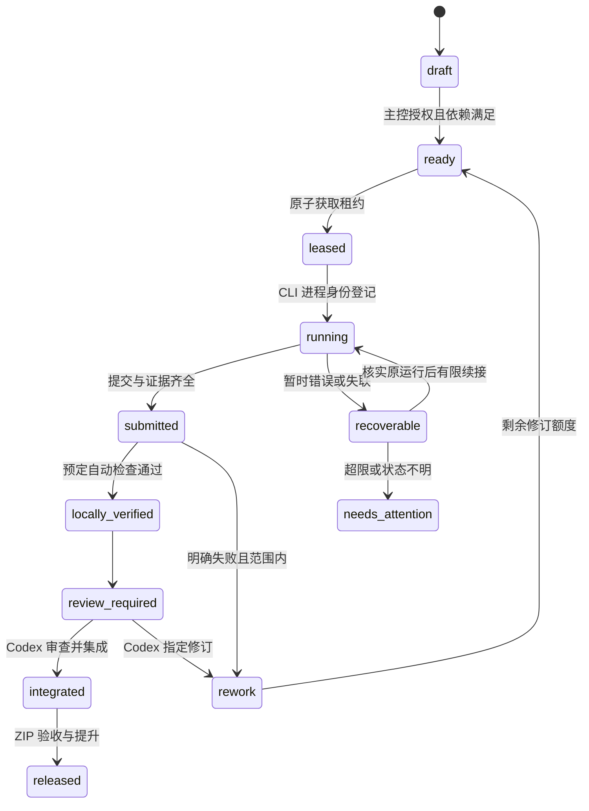

# Codex 不在线时的有限持续开发规则

日期：2026-10-23。设计状态：CLI 派单/指定会话续接已用真实任务验证；**持久队列、租约、自动恢复和以下 runner 尚未实现**。本轮不启动无人值守开发。入口：[产品方案](../PRODUCT-PLAN-2026-10-23.md)、[逐项任务](product-task-catalog.md)。

## 1. 解决什么问题

Codex 提前把产品决策转成带验收的有限任务包。Qoder、Antigravity 使用各自账号/官方 CLI 执行；本机 runner 不依赖 Codex 当前回合，负责投递、记录、超时、恢复与停止。Codex 可回来审查一个批次，无需每个小步骤都消耗一次主控额度。

OpenAI 官方说明：用量受模型、任务与上下文等影响，local/cloud 共享用量，可能还有周限制；不同订阅窗口不完全一致。因此调度不能硬编码“启动后五小时自动切换”，更不能保证额度见底时一定有回调。[OpenAI 官方用量说明](https://learn.chatgpt.com/docs/pricing)

正确机制是：主控在线时**预先授权并武装一个批次**；执行器发现 ready 任务就推进。主控离线、额度不足、app 关闭都不改变任务权限。是否能在 Windows 登出/重启后继续，取决于 runner 启动机制与账号可用性，必须单独验证。

## 2. 角色与权力

| 角色 | 可做 | 不可做 |
| --- | --- | --- |
| Codex 主控 | 产品取舍、冻结接口、授权批次、审查、集成、正式平台安装与发布 | 绕过用户明确验收要求、混入他人脏改动 |
| Qoder | 被授权的数据/逻辑/存储/表现任务；自己分支提交；提供证据 | 合 main、改另一任务/全局插件、偷偷换模型/权限 |
| Antigravity | 被授权的 UI/交互/校准/渲染任务；自己分支提交；提供证据 | 同上；不能把源码报告写成真实画面验收 |
| DSH | 只执行 DSH 兼容性用例、记录复现 | 承担日常开发与其他平台验收 |
| 本机 runner | 校验任务包、独立启动 CLI、收集产物、有限重试、到界限停止 | 自行生成新需求、变更契约、自动批准权限、判断最终产品验收 |

主控不可用时不转移合并权。另一个 Worker 可按独立只读审查任务检查候选，结果仍为建议。产品主分支和 stable 版本在主控审查前保持不变。

## 3. 任务包必须足够完整

仓库内存产品/任务说明、接口 fixture、验收命令和无秘密的状态摘要；运行记录、会话 ID、端点、profile、租约、stdout/stderr 与机器路径放本地临时目录。`Uta-Workspace` 已于 2026-10-24 弃用，不再新建任务区或验证记录。个人模型/密钥/音频/聊天原文不入 Git。

任务包必填：完整名称、owner、冻结基线、契约版本/哈希、依赖、允许修改路径、禁止路径、预期行为、非目标、失败场景、验收命令、GUI 要求、产物位置、最大尝试次数、停止点、是否允许同 owner 后续任务栈。

`scripts/workspace.mjs` 当前只建 worktree/assignment，**不是派单调度器**；其默认“npm ci”提示也不适用于只读研究。实施 runner 时按任务类型生成 instructions，纯文档/只读任务不安装。现有脚本继续保留为目录管理入口。

## 4. 状态机与依赖

`submitted` 不等于验收；`locally_verified` 不等于合并。依赖分为两种：

- **集成依赖**：必须依赖任务已 integrated，不能用另一个 Worker 的未审查输出当稳定 API。
- **预授权栈依赖**：同 owner、同受控分支栈、明确前置 head/检查通过，可在候选提交上继续下一项。只表示候选叠加，仍不进入 main。跨 owner 不能默默 cherry-pick；交接必须由主控提前批准的候选 bundle/hash 才可使用。

这样既能连续做多项，又不假装多个未合并候选已经构成稳定集成环境。没有可执行任务就待命，不能为了“持续”而自行扩需求。

## 5. 本地 runner 的最小实现规格

建议新增 `scripts/dispatch/`，与 Uta 产品运行时彻底分开。使用 Node 内置 fs/child_process；第一版不引入数据库/云服务，不把 runner 塞进桌宠进程。所有 CLI 使用绝对路径、参数数组、`windowsHide:true`；不拼接 Shell 字符串。

### 持久状态

- `batches/<batchId>.json`：授权来源、允许任务 IDs、只允许工具/命令、预算、armed/paused/finished 状态。
- `tasks/<taskId>.json`：任务状态、attempt、候选 SHA、依赖解析、最近错误/下一步。
- `runs/<runId>/`：prompt、命令的脱敏 argv、环境白名单、CLI 版本、session/conversation ID、事件、退出码、检查结果与结果摘要。
- `leases/<resource>.json`：task/run、PID、进程创建时间、exe、续租时间、有效期；资源含 Worker 槽、worktree、共享平台配置锁、GUI 端口。
- `events.jsonl`：只追加状态变化，序号/时间/事件ID。快照原子替换，写临时文件→flush→rename；恢复时可回放日志。

获取锁采用独占创建；锁过期只表示需要核实。PID 可能复用，必须核对可执行路径、创建时间与所属命令；确认原 CLI 已停止后才重新租用。不按历史 PID 杀进程，不删除其他任务目录。

### 启动前检查

检查工作目录/分支/base/dirty、依赖状态、合同哈希、允许文件、profile路径、端点无回退、模型策略、可用工具。脏任务区若属于本 run 可恢复；未知脏改动停下交接。不得自动 reset/clean、递归删除或强推。

依赖安装限于任务自己的 app/plugin 指定目录，不链接共享 node_modules/out/dist。任务不能覆盖整个 APPDATA。实际 CLI 待遇以请求与返回元数据分开登记。

### 投递与观察

投递前先持久化 runId/任务 attempt，然后启动进程并登记身份，解析官方 stream-json。通过 init/result 取得确切会话 ID，不能使用“最近会话”。只处理可识别事件，不把思考正文展示到台账。

退出码为 0 只是一个条件；还必须检查 result 成功、拒绝/错误工具调用、worktree差异范围、提交、要求的测试和结果文档。stdout“完成了”但没有产物时，状态为 needs_attention/rework，不能自动放行。

### 中断与取消

用户 pause：不再租新任务，当前任务可按明确模式完成或取消。cancel：向所属 CLI 请求正常退出，等待有界宽限；必要时仅终止已验证属于本 run 的进程树，记录未完成现场。窗口关闭/账号登录/系统睡眠分别记状态，不把无输出统一当失败。

runner 崩溃后先核实原进程和服务端会话：已完成则收集产物；仍在运行则附着观察；状态不明标记 unknown-completion，不能直接重发有副作用任务。绝不承诺“跨平台恰好一次执行”，用 task/run幂等标识、有限续接和产物核验降低重复。

### 失败与重试

默认每任务最多 1 次初始尝试 + 1 次技术重试 + 1 次范围内修订；合同可以更严格。网络/暂时CLI故障指数退避并持久化；账号认证/额度不足/权限拒绝不反复试。已完成提交不能因上传/日志失败重做代码；只恢复收集步骤。

同一问题两次失败或需要更改接口/扩大范围，停在 needs_attention。不要两 Worker 互相修对方分支形成无限循环。任务预计超时后先停止新投递、收集现场，不能自动提高权限/换模型。

## 6. 平台差异与已知障碍

Qoder 固定 `DeepSeek-Flash --reasoning-effort max --context-window 1000000`，包括探针/续接。`QODERCN_SUBAGENT_MODEL=DeepSeek-Flash`；任务默认禁止再开子 Agent。显式工具白名单、空 MCP 配置与 strict 模式适用于纯代码任务，不触发桌宠。服务端实际生效的思考/窗口上限未报告，日志只能证明请求与模型名。

Antigravity 保持 `gemini-3.8-flash-high`，用确切 conversation ID 续接。旧 `uta-deskpet` 0.1.5 插件仍有隔离缺陷，目前临时停用→推理→finally恢复是人工研究的措施，**不满足无人值守长期并行要求**。必须先修隔离或证明 CLI 独立配置根不加载该插件；否则批次不许 armed。若不得不临时改全局插件，需互斥、原状态日志、崩溃恢复，且在主控在线的验证批次进行。

两个 Worker 的模型额度也可能耗尽。各平台 independently 暂停任务，不自动切别的平台执行同一副作用任务；预授权的独立任务可以由仍可用的平台继续。登录需人工时明确提示，不抓取/转存令牌。

本轮每个参考审查采用只读工具与独立 worktree；正式代码任务需要 Edit/Write/Shell 时，白名单必须按合同重新批准，不能直接继承只读研究配置后声称能开发。

## 7. 可控的无人值守批次

初始默认：最多 2 个 Worker、每个平台 1 个运行任务；每批最多 6 个任务；单任务软时限 45 分钟、硬时限 90 分钟；批次墙钟上限 6 小时。长任务拆成可审查提交，不能只把时限调大。这些是实施提案的初值，不是已配置的定时器。

同一文件的 owner 唯一。`app/package.json`/lock、preload/shared IPC、loader核心、总台账和AGENTS由主控或独占集成任务改，Worker 要新增测试注册/依赖时交补丁说明。不得两个任务同时改同一公共文件然后交给 Git 猜语义冲突。

每个完成任务提交 result 文档，列已做/未做、head/base、测试命令与真实结果、GUI是否执行、允许范围内差异、遗留进程身份、下一依赖。阶段性commit后做简短摘要，runner面板/摘要能看出进度。没有明确用户授权，不自动向邮件/聊天服务发消息。

主控回来后的固定流程：读取批次摘要 → 确认每个候选SHA/范围 → 复查核心行为与失败路径 → 在独立集成区按依赖顺序合候选 → 跑必要检查 → 真GUI → main → 另建ZIP候选并验收。Worker不会用“主控缺席”跳过步骤。

## 8. 最小命令界面（待实现）

建议统一命令：`validate <batch>`、`arm <batch>`、`run <batch>`、`status <batch>`、`pause <batch>`、`cancel <run>`、`recover <batch>`、`collect <run>`。这些是接口提案，**当前不能直接运行**。

arm 必须由主控/用户明确授权；任务内容或合同哈希改变即解除武装。run 不能暗中 arm。第一次验证不注册开机启动；通过崩溃恢复演练后再提供可选后台启动方案。runner本身不包含固定个人路径和认证材料。

## 9. 调度器验收矩阵

先假 CLI：正常成功、result失败但exit0、输出截断、工具拒绝、长无输出、权限请求、超时、取消、runner崩溃、PID复用、重复投递、锁过期原进程仍在、未知完成状态、跨范围改动、合同哈希变更、未提交产物。

再真实 CLI：Qoder/Antigravity 各一个小型隔离任务及指定会话续接；主控停止后下一 ready 任务仍能开始；main/stable/日常profile始终未变化；旧插件恢复/隔离得到证明。若停止执行器只退出了当前shell而CLI还在运行，不能算取消成功。

最后 6 小时有限批次演练：记录任务转移、休眠恢复、平台额度不足、结果收集与主控集成。未完成此演练，文档只写“可手动派单”，不写“已可自动持续开发”。
