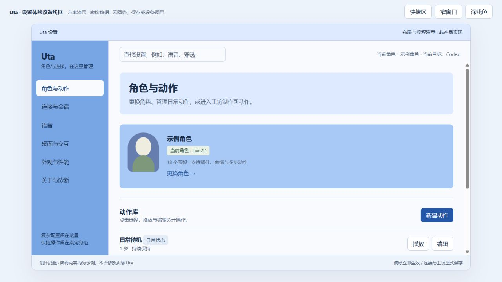

# 产品化、Live2D 表现与持续开发规划交付

日期：2026-10-23。主控Codex。本轮仅研究、文档、单文件线框；没有产品实现/依赖变更/发版，没有启动实施队列。

## 交付入口

- [产品总方案](../../PRODUCT-PLAN-2026-10-23.md)：定位、用户旅程、范围、阶段、发布/回退、风险与门槛。
- [Live2D架构与验收](../../design/live2d-performance-plan.md)：真实现状、语义意图、模型Profile、通道/阶段控制、时钟、导演、语音、渐进迁移、性能与画面验收。
- [Soullink/AIRI研究](../../design/live2d-reference-study.md)：源码/业务接线/测试与未验证范围、取舍和主控纠错。
- [蓝色大色块设计规范](../../design/blue-block-design-spec.md)：图标依据、tokens、布局、表单状态、深浅色与代表页要求。
- [持续开发规则](../continuous-development-plan.md)：runner规格、状态机、租约/恢复/防重、预算、隔离、主控离线边界。
- [20项实施任务包](../product-task-catalog.md)：owner/依赖/允许范围/成果/失败用例/验收/停止点，以及首次有限队列。

已更新AGENTS、CURRENT、旧路线与设置方案入口。`agent.md`继续指向唯一协作规则AGENTS，不复制第二套容易漂移的规则。

## 真实外部派单与审查

| 平台与完整任务 | 会话与状态 |
| --- | --- |
| Qoder：Soullink表现系统只读研究 | `88cf1813-6eea-4c98-91e3-90dbd88ef6ff`；CLI exit0，result非错误，permission_denials为0；init模型DeepSeek-Flash；工具Read/Glob，未写文件 |
| Antigravity：AIRI控制能力只读研究及修订 | `e903b02b-42ce-48ff-8a88-60a928b6c165`；两次exit0/result SUCCESS，初稿read_file，修订实际读取追加资料；未实施产品 |

Qoder显式请求max/1,000,000上下文，服务端实际档位/窗口未回传。Antigravity使用gemini-3.8-flash-high；旧uta-deskpet插件每次推理前停用、finally启用成功。此临时措施不是无人值守隔离完成的证据。

原始日志/提示词/manifest保存在仓库外`operations/runs/qoder-soullink-expression-audit`与`operations/runs/antigravity-airi-expression-audit`；不入Git。两个Worker分支只包含主控下发的研究合同，未修改产品代码；主控用git核实工作树干净，不能以Worker未用Shell的自述代替。

主控没有照收报告：纠正Antigravity的PIXI/Pinia版本、表情释放与弹簧稳定性判断；对Soullink补查public API和renderer实际实现，限制“不在快照”结论的适用范围。最终以研究/架构文档为准。

## 视觉与检查范围

[深色语音页截图](../../design/settings-ux-blue-dark-preview.png)。保留大色块，主色蓝；浅蓝区用深色文字，深色侧栏用浅色文字。旧暖色方向已从有效规范中替换。

浏览器实际检查：1280×720角色页、语音导航、深浅主题、660px演示框的窄布局；修复观察到的深色侧栏文字对比问题后重新截图。原型仍为虚构数据，无保存/网络/设备/真实窗口调用；未测真实Windows DPI/所有键盘流程，不冒充完整无障碍审计。

静态检查：改动文档相对链接存在、内联JS语法、git diff --check；抽查关键色对文字对比度。纯文档/原型改动不重复跑应用/插件测试，既有288/104结果属于上轮源码验收，不写成此次新测试结果。

## 现场与下一步

- 产品基线为`509e15b2e337be8dbaa6349b92346e611dc88223`；研究合同提交`ae7c293`。新规划与线框在Codex任务worktree完成，随后主控合并文档；不改变日常0.1.1/dcf1b3f ZIP版。
- Soullink原有package-lock脏改保留，AIRI保持干净，两参考仓库HEAD未变；未装依赖/启动参考应用。
- 主目录三份历史脏文档保留：AGENT-PORTABILITY-PLAN、IMPLEMENTATION-P2-L0、ITERATION-ROADMAP-2026-10-13，未暂存/提交。
- 预览仍为`http://127.0.0.1:9281/`，只读服务改为本轮worktree线框。PID/启动时间/文件路径在仓库外`operations/settings-ux-20261023/preview-process.json`。重启前核实进程exe/创建时间/监听端口，不按历史PID盲停；后续清理也应同样核实。
- 没有实施任务ready/armed。下一步用户确认总方案后由Codex冻结契约/基线，再派第一批有限任务；不要自动开始改loader或开第二套设置store。
